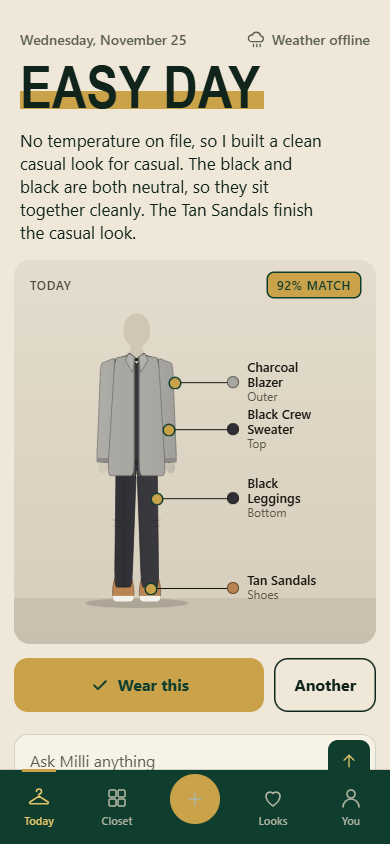
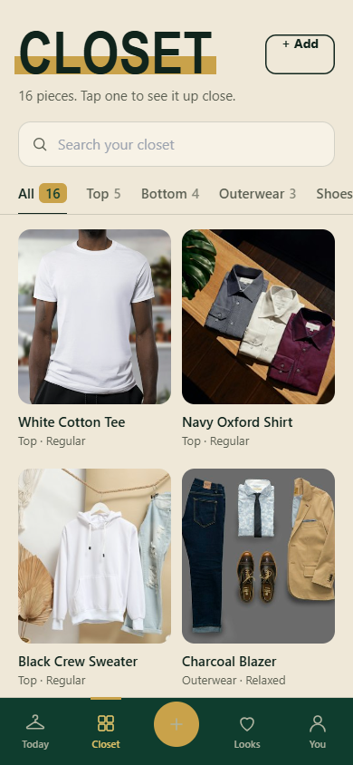
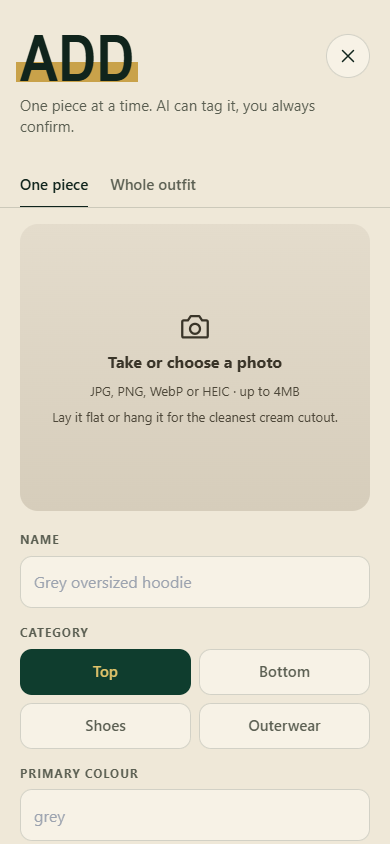
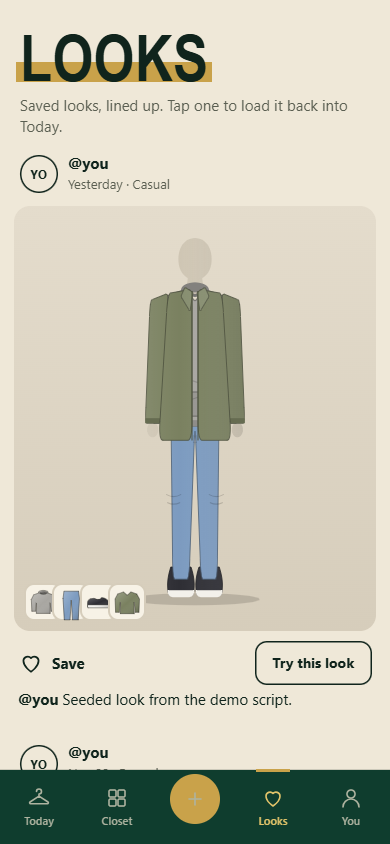
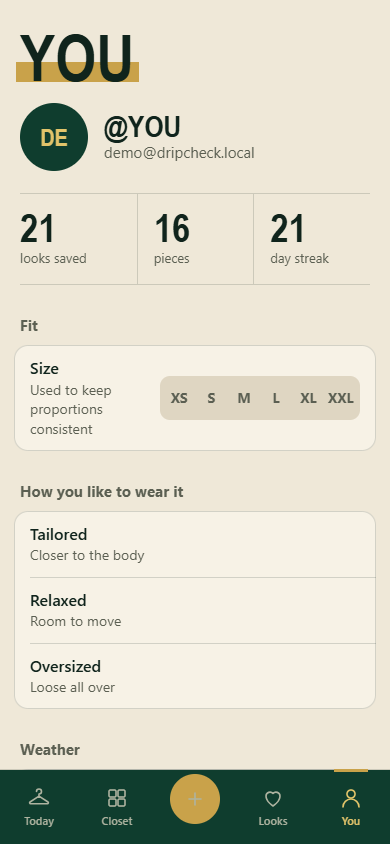
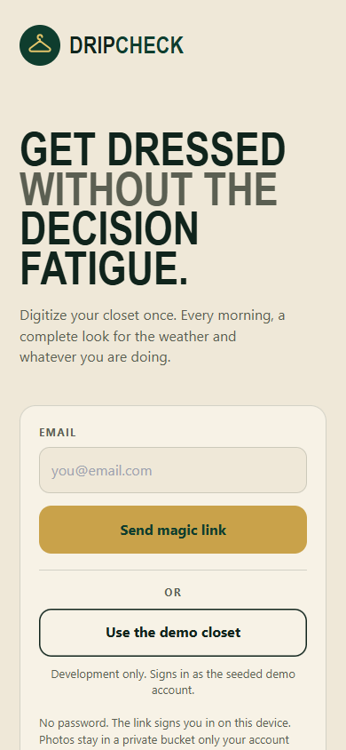
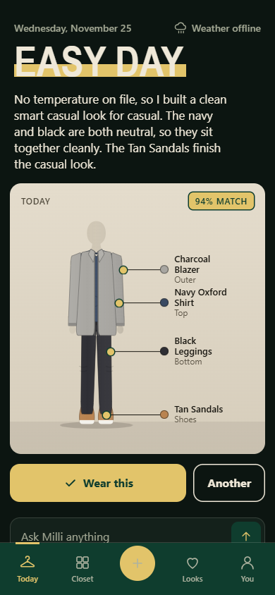
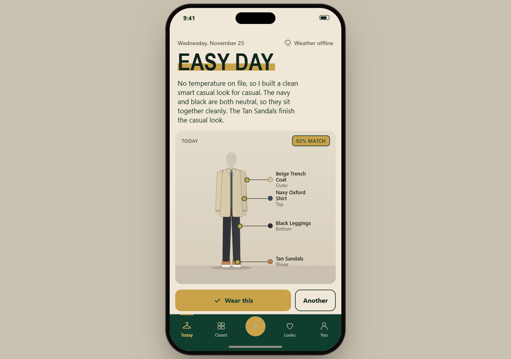

# DripCheck

**A private closet that styles a complete outfit every morning.**

DripCheck is a phone-first wardrobe app. Photograph your clothes once, let AI fill in the
details, and get a complete look for the weather that only uses pieces you own.

It started as a hackathon build and grew into a working P0 + P1 product: real auth, private
storage, a rules-first outfit engine, Milli the stylist, and a local background remover that
puts every piece on the same cream background.

<p align="center">
  
</p>

## What it does

- **Today** — a mannequin look built from your wardrobe, with the weather, a plain-language
  reason, a match score, wear logging, a weekly preview and a streak.
- **Closet** — search, category filters, garment flats or private photos, item details,
  cost-per-wear, laundry status and “build a look around this”.
- **Add** — one piece with AI tagging, or scan a whole outfit and confirm every piece before
  saving. Photos are optional; the drawn garment flats always work.
- **Cream cutouts** — one-piece photos are cut out locally and composited onto the app’s cream
  background. Suspicious masks are flagged, and the original is always one tap away.
- **Milli** — “warmer”, “dressier”, “swap shoes”, “all black”, “another”, or an occasion.
  Milli restyles over a validated endpoint and never invents clothes.
- **Looks** — every logged outfit, with save / favourite and “try this look”.
- **You** — size, silhouette preference, weather city, lifetime stats and sign out.

## A look inside

| Closet | Add a piece | Looks archive |
|---|---|---|
|  |  |  |
|  |  |  |

<p align="center">
  
</p>

The screenshots use the seeded demo closet. They are real captures, not mockups.

## Stack

| Layer | Choice |
|---|---|
| App | Next.js 14 App Router + TypeScript strict + React 18 |
| Styling | Hand-written CSS tokens/shell/screens; Archivo + Instrument Sans |
| Data / auth / storage | Supabase Postgres, magic-link auth, private Storage |
| Validation | zod on every mutation body |
| AI | NVIDIA NIM (preferred), Featherless (text fallback), Gemini (vision fallback) |
| Cutout | Local BiRefNet-lite 512 (MIT) via Transformers.js + ONNX Runtime, on `#EFE8D8` |
| Weather | OpenWeather behind a server proxy (optional) |
| Tests | Vitest + a rules-engine verification script; CI runs lint, typecheck, tests and a build |

## Run it locally

You need Node 22+ and Docker for the local Supabase stack.

```bash
git clone https://github.com/sharvindev6-hue/dripcheck.git
cd dripcheck
npm install
npx supabase start
npx supabase db reset
```

`npx supabase status` prints the local API URL and publishable key. Put them in `.env.local`:

```bash
cp .env.example .env.local
```

```text
NEXT_PUBLIC_SUPABASE_URL=http://127.0.0.1:55321
NEXT_PUBLIC_SUPABASE_ANON_KEY=<publishable key from supabase status>
```

Then run:

```bash
npm run dev
# http://localhost:3000
```

Open the app, enter an email, follow the magic link, and add three pieces (top, bottom, shoes).
Milli can then build a complete look.

### Seed the demo closet

The demo user needs the service-role key, so keep it server-side only.

```bash
DEMO_SEED=true \
SUPABASE_URL=http://127.0.0.1:55321 \
SUPABASE_SERVICE_ROLE_KEY=<secret key from supabase status> \
DEMO_USER_EMAIL=demo@dripcheck.local \
npx tsx scripts/seed-demo.ts
```

The seeder creates 16 pieces and 21 days of outfit history ending today, all marked worn.
During local development, the login screen also shows **Use the demo closet** when
`DEMO_USER_EMAIL` and `SUPABASE_SERVICE_ROLE_KEY` are set. The button and its route return 404
outside `NODE_ENV=development`.

### Use a hosted Supabase project instead

1. Run `supabase/migrations/0001_recovery.sql` in the SQL editor.
2. Enable **Authentication → Providers → Email**.
3. Add `http://localhost:3000/auth/callback` and your production callback URL to the redirect
   allow list.
4. Set `NEXT_PUBLIC_SUPABASE_URL` and `NEXT_PUBLIC_SUPABASE_ANON_KEY` in `.env.local`.

The AI and weather keys are optional. Without them the app stays fully usable in rules mode
with a manual weather fallback.

## How it works

```text
Browser (phone shell)
  │  reads: Supabase (RLS-scoped)
  │  writes: only through route handlers
  ▼
Next route handlers
  ├── /api/items[/id]      create / update / delete + storage cleanup
  ├── /api/outfits[/id]    upsert by (user, date), slot validation, wear counters
  ├── /api/profile         size / silhouette / city
  ├── /api/stats           lifetime streak and cost-per-wear
  ├── /api/stylist         rules first → AI → validated fallback
  ├── /api/chat            intent-based restyle with validated ids
  ├── /api/vision          single-item AI tags
  ├── /api/extract         multi-item outfit scan
  ├── /api/cutout          local BiRefNet cutout → cream PNG
  ├── /api/weather         OpenWeather proxy
  └── /auth/callback       PKCE code exchange
        │
        ├── Supabase Postgres + RLS
        ├── Supabase private Storage + signed URLs
        └── optional AI / weather providers
```

Rules come first. The deterministic engine always produces a valid look; Milli is a layer on
top, never a dependency. If an AI provider is missing, slow or returns nonsense, the app falls
back without pretending the model answered.

## Cutouts

One-piece photos run through a local BiRefNet-lite 512 model and are composited onto the app’s
cream background (`#EFE8D8`).

- The first cutout downloads ~183 MB and can take 20–30 seconds. Later cutouts are usually
  around 5–7 seconds on CPU.
- Flat lays and hangers against a contrasting background work best.
- Worn photos isolate the person, not only the garment.
- A blank or suspicious mask is flagged in the add screen. Use **Use original photo** to skip it.
- No segmentation model is error-free. Review the edges before saving.

The model is MIT-licensed and stays on the machine running the app; only the one-time model
download leaves the device.

## Project map

```text
src/app/                 routes and route handlers
src/components/          shell, tabs, mannequin, chat, sheets, icons
src/lib/                 rules engine, stats, Supabase, AI, cutout, validation
src/styles/              design tokens, shell, screens
scripts/                 demo seeder and engine check
supabase/migrations/     idempotent schema + RLS + private storage
docs/screenshots/        real app captures used above
DESIGN.md                visual contract (Bottle Green + Brass)
PLAN.md                  recovery / security / design plan
LEARNING_LOG.md          what broke and what I learned
```

## Checks

```bash
npm run check       # lint + typecheck + unit tests
npm run build       # production build, no real secrets needed
npm run verify:engine
```

CI runs lint, typecheck, tests and a production build with dummy Supabase values on every push
to `main` or `recovery/**`.

## Design

The source of truth is [`DESIGN.md`](DESIGN.md) and the CSS files it lists. The short version:
warm bone surfaces, a deep bottle-green shell, brass accents, Archivo display type and Instrument
Sans body copy. Mobile is full-screen; desktop is a centred phone frame. There is no separate
desktop layout.

## Known limits

- The cutout is best-effort, not magic. Thin straps, transparent fabric, low-contrast clothing
  and worn garments can fail. The UI gives you a review state and an original-photo fallback.
- The repo does not contain live Supabase, AI or weather credentials. The verified checks are
  lint, typecheck, unit tests and production builds. Live auth / storage / AI calls need your
  own project.
- Rate limiting is per server instance. A multi-instance deployment should use a shared store.
- HEIC decoding depends on the browser. The upload route and bucket accept it, but some browsers
  cannot preview HEIC locally.
- `npm audit` flags known Next.js 14 advisories. The app does not use Server Actions, the
  `next/image` optimizer, rewrites or a custom server, which removes several named paths, but a
  framework major upgrade is the real fix and is a separate migration.
- Looks is a personal saved-look archive. Social feeds, reactions, scheduled notifications,
  payments and a native app are not part of this build.

## License

Private project. All rights reserved.
